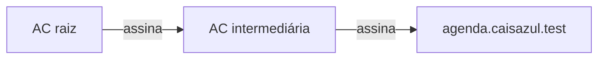

# Laboratório: a AC da turma — do par de chaves ao .pfx

> Disciplina **Segurança de Sistemas** · Atividade prática sobre certificados digitais

Neste laboratório você vai usar o **OpenSSL** para criar uma cadeia de certificados para o **PortalAgenda** da Cais Azul, empresa fictícia de logística portuária usada nas aulas. Depois, vai gerar um pacote **`.pfx`** e utilizá-lo em um servidor HTTPS.

Toda a revisão teórica, o roteiro e as orientações de entrega estão neste README. A atividade roda no **GitHub Codespaces**, uma máquina Linux acessada pelo navegador, sem instalação no computador do laboratório.

## Como começar

1. Acesse o [repositório modelo da atividade](https://github.com/SegurancaSistemasInternet/laboratorio-certificados) e leia a revisão teórica abaixo.
2. Depois da leitura, acesse o [início das atividades práticas](#etapa-0--preparar-o-ambiente). A etapa 0 orienta a criação do **seu próprio repositório a partir do template** e a abertura do Codespace nele.
3. Execute o roteiro no seu Codespace e envie as evidências na **equipe do Teams da disciplina**, no local indicado pelo professor.

**Não abra o Codespace no repositório modelo.** Use o menu **Code → Codespaces** do seu repositório, criado na sua conta.

## Revisão teórica

### Chaves, assinaturas e certificados

Na criptografia assimétrica, cada participante possui uma **chave privada**, que deve permanecer secreta, e uma **chave pública**, que pode ser distribuída. Uma assinatura digital feita com a chave privada pode ser verificada com a chave pública correspondente.

Receber uma chave pública não basta para saber a quem ela pertence. Um atacante pode apresentar sua própria chave no lugar da chave de um site. O **certificado digital** associa uma chave pública a uma identidade, com a assinatura de uma **Autoridade Certificadora (AC)**.

Neste laboratório, as chaves usam a curva elíptica **P-256**, e os certificados são assinados com **ECDSA e SHA-256**. O hash gera um resumo dos dados; a assinatura permite verificar sua integridade e autoria.

Um certificado **X.509** contém:

| Campo | Conteúdo |
|---|---|
| Titular (*Subject*) | Identidade associada à chave pública |
| Emissor (*Issuer*) | AC que assinou o certificado |
| Número de série | Identificador atribuído pela AC |
| Validade | Datas de início e fim |
| Chave pública | Chave do titular |
| Extensões | Restrições e usos permitidos |
| Assinatura | Assinatura digital da AC sobre o certificado |

**O certificado não contém a chave privada.** Ele pode ser distribuído publicamente.

### Cadeia de confiança

A **AC raiz** possui um certificado autoassinado. A confiança nela vem de uma decisão do sistema ou do usuário, e não apenas dessa assinatura. Sistemas operacionais e navegadores mantêm uma lista de raízes confiáveis, chamadas **âncoras de confiança**.

A raiz assina o certificado de uma **AC intermediária**, que emite os certificados dos sites:



O cliente verifica essa cadeia até chegar a uma raiz em que confia. A raiz criada nesta atividade **não é confiável fora do laboratório**: vamos indicá-la explicitamente ao OpenSSL na validação local.

O conjunto de autoridades, certificados e regras é uma **PKI** (infraestrutura de chaves públicas). No Brasil, a **ICP-Brasil** é a infraestrutura oficial de certificação digital.

### Extensões do certificado

As extensões definem os usos permitidos. Quando uma extensão é **crítica**, o cliente deve entendê-la; caso contrário, deve recusar o certificado.

| Extensão | Raiz | Intermediária | Site |
|---|---|---|---|
| `basicConstraints` | `CA:TRUE` | `CA:TRUE, pathlen:0` | `CA:FALSE` |
| `keyUsage` | Assinar certificados e listas de revogação | Mesmo uso da raiz | Assinatura digital |
| `extendedKeyUsage` | — | — | `serverAuth` |
| `subjectAltName` (SAN) | — | — | `DNS:agenda.caisazul.test` |

`pathlen:0` impede que a intermediária tenha outra AC abaixo dela na cadeia validada. `CA:FALSE` impede que o certificado do site seja aceito como uma AC. O **SAN**, e não apenas o nome comum (`CN`), indica os nomes válidos para o site.

As configurações já estão em [config/raiz.ext](config/raiz.ext), [config/intermediaria.ext](config/intermediaria.ext) e [config/site.ext](config/site.ext).

### Pedido de certificado (CSR) e verificação

O dono do site gera a chave privada e um **CSR** (*Certificate Signing Request*). O pedido contém a chave pública e a identidade solicitada, com uma assinatura feita pela chave privada correspondente. **O CSR não contém a chave privada.**

A AC verifica o pedido, valida a identidade conforme suas regras e decide as extensões do certificado. Aqui, essa emissão será simulada com os arquivos de configuração.

Ao validar um certificado, o cliente verifica a cadeia de assinaturas, a confiança na raiz, as datas, o nome e os usos permitidos. A revogação também pode fazer parte da validação, mas não será configurada nesta atividade.

| Falha | Exemplo de alerta no navegador |
|---|---|
| Cadeia incompleta ou raiz não confiável | `NET::ERR_CERT_AUTHORITY_INVALID` |
| Certificado fora da validade | `NET::ERR_CERT_DATE_INVALID` |
| Nome diferente do SAN | `NET::ERR_CERT_COMMON_NAME_INVALID` |

### Formatos de arquivo e PFX

**DER** é uma codificação binária. **PEM** representa o conteúdo em Base64, entre linhas como `-----BEGIN CERTIFICATE-----` e `-----END CERTIFICATE-----`.

| Arquivo | Conteúdo habitual | É segredo? |
|---|---|---|
| `.crt`, `.cer` | Certificado, em PEM ou DER | Não |
| `.csr` | Pedido de certificado | Não |
| `.key` | Chave privada | **Sim** |
| `.pem` | Certificado, cadeia ou chave | Depende do conteúdo |
| `.pfx`, `.p12` | Pacote PKCS#12, que pode incluir chave privada e certificados | **Sim, quando contém chave privada** |

O **PFX (PKCS#12)** reúne, nesta atividade, a chave privada do site, seu certificado e os certificados das ACs. Ele facilita a importação em sistemas como Windows e IIS. Certificados **A1 da ICP-Brasil**, usados para assinatura de documentos e emissão de notas fiscais, podem ser armazenados nesse formato.

No OpenSSL 3, a exportação padrão protege a chave privada e os certificados com **AES-256-CBC**, usando **PBKDF2** para derivar a chave de cifragem da senha. Um **MAC** permite detectar alterações no pacote e falhas na verificação da senha. O `friendlyName` é o nome amigável exibido na importação.

**Quem possui o PFX e sua senha pode recuperar a chave privada.** Não publique nenhum dos dois.

## Roteiro da atividade

### Tempo previsto

Reserve cerca de **85 minutos para a prática**, após a revisão teórica. Os tempos abaixo incluem a criação do repositório do aluno, a preparação do Codespace, a execução dos comandos, os checkpoints e a coleta das evidências. A primeira criação do Codespace pode levar alguns minutos adicionais.

| Etapa | Atividade | Tempo estimado |
|---|---|---|
| 0 | Criar seu repositório a partir do template e preparar o Codespace | 10 min |
| 1 | Criar a AC raiz | 8 min |
| 2 | Criar a AC intermediária | 8 min |
| 3 | Gerar a chave e o CSR do site | 7 min |
| 4 | Emitir o certificado do site | 7 min |
| 5 | Verificar a cadeia | 10 min |
| 6 | Gerar e inspecionar o PFX; coletar a evidência 1 | 10 min |
| 7 | Abrir o servidor HTTPS no navegador, validar a conexão e coletar a evidência 2 | 20 min |
| 8 | Enviar as evidências no Teams e encerrar | 5 min |
| **Total** | **Atividade prática** | **85 min** |

[Iniciar as atividades práticas — Etapa 0](#etapa-0--preparar-o-ambiente)

Execute os comandos no **terminal Linux do Codespace**, dentro de `trabalho/`. Os caminhos `../config/` apontam para as configurações já fornecidas. Datas e números de série variam a cada execução.

Ao final de cada etapa, use o **checkpoint** para conferir o resultado antes de avançar. Se ele não corresponder ao esperado, confira a pasta atual, os nomes dos arquivos e as opções do comando; corrija a etapa antes de continuar. Os erros dos testes negativos da etapa 5 são intencionais.

As evidências serão coletadas em apenas dois momentos: **ao final da etapa 6** (cadeia e PFX) e **ao final da etapa 7, com o servidor ainda ligado** (HTTPS). Os demais checkpoints não precisam de captura.

> As chaves ficam sem senha no disco apenas para simplificar o laboratório. Não use essa configuração em produção nem instale a raiz da turma no navegador do dia a dia.

### Etapa 0 — Preparar o ambiente

1. Entre na sua conta do GitHub e abra o [repositório modelo](https://github.com/SegurancaSistemasInternet/laboratorio-certificados).
2. Clique em **Use this template → Create a new repository**. Não use **Fork**: nesta atividade, a cópia deve ser criada a partir do template.
3. Em **Owner**, selecione **sua conta pessoal**. Em **Repository name**, use `laboratorio-certificados` ou outro nome indicado pelo professor. Se esse nome já existir na sua conta, escolha um nome disponível.
4. Defina a visibilidade conforme a orientação do professor e clique em **Create repository**.
5. Confira que o endereço do novo repositório tem o formato `https://github.com/SEU-USUARIO/SEU-REPOSITORIO`, e não começa com `https://github.com/SegurancaSistemasInternet/`.
6. **No seu novo repositório**, clique em **Code → Codespaces → Create codespace on main** e aguarde a preparação. Se solicitado, autorize a criação do Codespace na sua conta.
7. Quando o editor abrir, use o terminal na parte inferior. Se ele não aparecer, selecione **Terminal → New Terminal**.

O terminal do seu Codespace já deve abrir em `trabalho/`. Confira:

```bash
pwd
openssl version
```

O caminho deve terminar em `/trabalho`, e a versão deve ser **OpenSSL 3.x**. Se necessário, entre na pasta:

```bash
cd /workspaces/*/trabalho
```

**Checkpoint 0 — Repositório e ambiente prontos:** confirme que o repositório foi criado na sua conta e que o Codespace foi aberto a partir dele. Execute novamente `pwd` e `openssl version`: o caminho deve ser `/workspaces/SEU-REPOSITORIO/trabalho` e a versão deve ser OpenSSL 3.x. Avance somente após essas conferências.

### Etapa 1 — Criar a AC raiz

Gere a chave, crie o pedido e emita o certificado autoassinado, válido por 30 dias:

```bash
openssl genpkey -algorithm EC -pkeyopt ec_paramgen_curve:P-256 -out raiz.key

openssl req -new -key raiz.key \
  -subj "/C=BR/O=Cais Azul (Lab)/CN=AC Raiz Cais Azul (Lab)" -out raiz.csr

openssl x509 -req -in raiz.csr -signkey raiz.key -days 30 \
  -extfile ../config/raiz.ext -out raiz.crt

openssl x509 -in raiz.crt -noout -subject -issuer -dates -ext basicConstraints,keyUsage
```

**Checkpoint 1 — Raiz criada:** `subject` e `issuer` devem ser iguais, com `CN = AC Raiz Cais Azul (Lab)`, e as extensões devem mostrar `CA:TRUE` e `Certificate Sign, CRL Sign`. A mensagem `Certificate request self-signature ok` é normal: indica que a assinatura do pedido foi conferida.

### Etapa 2 — Criar a AC intermediária

Gere a chave e o pedido da intermediária. Em seguida, use a raiz para emitir seu certificado, válido por 15 dias:

```bash
openssl genpkey -algorithm EC -pkeyopt ec_paramgen_curve:P-256 -out intermediaria.key

openssl req -new -key intermediaria.key \
  -subj "/C=BR/O=Cais Azul (Lab)/CN=AC Intermediaria Cais Azul (Lab)" -out intermediaria.csr

openssl x509 -req -in intermediaria.csr -CA raiz.crt -CAkey raiz.key -CAcreateserial \
  -days 15 -extfile ../config/intermediaria.ext -out intermediaria.crt

openssl x509 -in intermediaria.crt -noout -subject -issuer -ext basicConstraints
```

**Checkpoint 2 — Intermediária emitida pela raiz:** o titular deve ser `AC Intermediaria Cais Azul (Lab)`, o emissor deve ser `AC Raiz Cais Azul (Lab)` e a extensão deve mostrar `CA:TRUE, pathlen:0`.

Os arquivos `.srl` criados pelo OpenSSL registram números de série utilizados na emissão.

### Etapa 3 — Gerar a chave e o CSR do site

Faça o papel do administrador do PortalAgenda:

```bash
openssl genpkey -algorithm EC -pkeyopt ec_paramgen_curve:P-256 -out site.key

openssl req -new -key site.key \
  -subj "/C=BR/O=Cais Azul (Lab)/CN=agenda.caisazul.test" -out site.csr

openssl req -in site.csr -noout -verify -subject
openssl req -in site.csr -noout -text
```

**Checkpoint 3 — Pedido válido:** a saída deve indicar `Certificate request self-signature verify OK`, mostrar `CN = agenda.caisazul.test` e incluir a seção `Subject Public Key Info`. A chave privada permanece em `site.key`, não no pedido.

O domínio `.test` é reservado para testes.

### Etapa 4 — Emitir o certificado do site

Leia [config/site.ext](config/site.ext) e use a intermediária para assinar o pedido:

```bash
openssl x509 -req -in site.csr -CA intermediaria.crt -CAkey intermediaria.key -CAcreateserial \
  -days 7 -extfile ../config/site.ext -out site.crt

openssl x509 -in site.crt -noout -subject -issuer -dates \
  -ext subjectAltName,extendedKeyUsage,basicConstraints
```

**Checkpoint 4 — Certificado do site correto:** confira o emissor `AC Intermediaria Cais Azul (Lab)`, o intervalo de **7 dias** entre `notBefore` e `notAfter`, `CA:FALSE`, `TLS Web Server Authentication` e `DNS:agenda.caisazul.test`.

### Etapa 5 — Verificar a cadeia

Valide a cadeia completa, o nome e o uso para autenticação de servidor:

```bash
openssl verify -CAfile raiz.crt -untrusted intermediaria.crt \
  -verify_hostname agenda.caisazul.test -purpose sslserver site.crt
```

O resultado esperado é **`site.crt: OK`**. `-CAfile` indica a raiz confiável; `-untrusted` fornece a intermediária para montar a cadeia, sem torná-la uma âncora de confiança.

Execute os testes abaixo **separadamente**. Eles devem falhar de propósito:

| Teste | Comando | Erro esperado |
|---|---|---|
| Sem intermediária | `openssl verify -CAfile raiz.crt site.crt` | `unable to get local issuer certificate` |
| Após a validade do site | `openssl verify -CAfile raiz.crt -untrusted intermediaria.crt -attime $(date -d '+10 days' +%s) site.crt` | `certificate has expired` |
| Nome diferente | `openssl verify -CAfile raiz.crt -untrusted intermediaria.crt -verify_hostname www.caisazul.test site.crt` | `hostname mismatch` |

Compare também os resumos da chave pública do certificado e da chave privada:

```bash
openssl x509 -in site.crt -noout -pubkey | sha256sum
openssl pkey -in site.key -pubout | sha256sum
```

**Checkpoint 5 — Cadeia e chave conferidas:** a validação completa deve retornar `site.crt: OK`, cada teste negativo deve apresentar o erro indicado na tabela e os dois resumos devem ser **idênticos**. Isso confirma a cadeia, as restrições testadas e a correspondência entre chave e certificado. A captura será feita na próxima etapa, junto com a inspeção do PFX.

### Etapa 6 — Gerar e inspecionar o PFX

Junte os certificados das ACs e exporte o pacote:

```bash
cat intermediaria.crt raiz.crt > cadeia.crt

openssl pkcs12 -export \
  -inkey site.key -in site.crt -certfile cadeia.crt \
  -name "agenda.caisazul.test" -out site.pfx
```

O OpenSSL pedirá uma senha e sua confirmação. Os caracteres não aparecem no terminal. Use uma senha exclusiva para esta atividade e não a inclua em comandos, capturas ou mensagens.

Para reunir os resultados da primeira evidência na mesma tela, repita a validação da cadeia e inspecione o pacote, informando a mesma senha:

```bash
openssl verify -CAfile raiz.crt -untrusted intermediaria.crt \
  -verify_hostname agenda.caisazul.test -purpose sslserver site.crt
openssl pkcs12 -in site.pfx -info -noout
```

**Checkpoint 6 — PFX criado corretamente:** confira `site.crt: OK`, **três `Certificate bag`** (site, intermediária e raiz), um **`Shrouded Keybag`** (chave privada cifrada) e as informações de **MAC**, **PBKDF2** e **AES-256-CBC**. A inspeção com `-noout` não exibe a chave privada.

**Colete agora a evidência 1 — Cadeia e PFX:** salve uma captura com os dois comandos acima e seus resultados legíveis. Amplie o painel do terminal se necessário. Não inclua senhas nem o conteúdo de arquivos de chave privada. Guarde a imagem para enviar no Teams na etapa 8.

### Etapa 7 — Usar o PFX em um servidor HTTPS

Extraia a chave, o certificado do site e a cadeia. Cada comando solicita a senha do PFX:

```bash
openssl pkcs12 -in site.pfx -nocerts -noenc -out recebido.key
openssl pkcs12 -in site.pfx -clcerts -nokeys -out recebido.crt
openssl pkcs12 -in site.pfx -cacerts -nokeys -out recebido-cadeia.crt
```

**`recebido.key` contém a chave privada sem senha.** Não abra seu conteúdo em capturas de tela.

Abra um **segundo terminal** e execute:

```bash
cd /workspaces/*/trabalho
openssl s_server -accept 8443 -www \
  -cert recebido.crt -key recebido.key -cert_chain recebido-cadeia.crt
```

Deixe o servidor rodando nesse terminal e abra a página pelo navegador:

1. No painel inferior do Codespace, abra a aba **PORTS / PORTAS**.
2. Se a porta **8443** não aparecer, clique em **Forward a Port / Encaminhar uma porta** e digite `8443`.
3. Clique com o botão direito na linha da porta **8443** e selecione **Change Port Protocol → HTTPS**. O protocolo padrão é HTTP e precisa ser alterado, pois o servidor deste roteiro usa HTTPS.
4. Mantenha a visibilidade em **Private / Privada**. Não é necessário tornar a porta pública para realizar a atividade.
5. Na linha da porta, clique em **Open in Browser / Abrir no navegador**. Se solicitado, entre com a mesma conta do GitHub usada no Codespace.

A página de status do OpenSSL deve aparecer, com informações da conexão e dos algoritmos disponíveis. O endereço terá o formato `https://NOME-DO-CODESPACE-8443.app.github.dev`. Use o endereço fornecido pelo painel, não `localhost` nem `agenda.caisazul.test` no navegador do seu computador.

Se a página não abrir, confira que o servidor continua rodando, que a porta encaminhada é **8443** e que o protocolo está em **HTTPS**. Depois, tente **Open in Browser** novamente. Não ignore alertas de certificado nem instale a raiz da turma no navegador para resolver esse acesso.

> **Atenção à diferença entre visualizar e validar:** o navegador acessa o servidor por meio do encaminhamento do Codespaces e recebe um certificado da infraestrutura do GitHub para `app.github.dev`, não o certificado de `agenda.caisazul.test`. A página aberta confirma o acesso à aplicação, mas não comprova a validade da cadeia criada no laboratório.

Por isso, volte ao **primeiro terminal**, dentro de `trabalho/`, e valide diretamente a conexão TLS com o servidor do laboratório:

```bash
openssl s_client -connect 127.0.0.1:8443 -servername agenda.caisazul.test \
  -CAfile raiz.crt -verify_hostname agenda.caisazul.test \
  -verify_return_error -brief < /dev/null
```

**Checkpoint 7 — Página acessível e certificado validado:** a página de status do OpenSSL deve aparecer no navegador pelo endereço encaminhado da porta **8443**. No primeiro terminal, o `openssl s_client` deve mostrar **`Verification: OK`**, sem erro de conexão ou de certificado. A opção `-CAfile raiz.crt` indica explicitamente a raiz confiável para essa validação.

**Colete agora a evidência 2 — HTTPS:** com o servidor ainda rodando no segundo terminal, organize duas janelas lado a lado: a página de status no navegador, com o endereço encaminhado visível, e o Codespace, com o primeiro terminal mostrando o comando `openssl s_client` acima e seu resultado `Verification: OK`. Salve **uma única captura** com os dois resultados legíveis. Guarde a imagem antes de encerrar o servidor.

A raiz está incluída na cadeia extraída do PFX, mas enviá-la pelo servidor não cria confiança no cliente: ele precisa confiar nela previamente. Em servidores reais, normalmente se enviam apenas o certificado do site e as intermediárias.

Referência: [encaminhamento de portas e uso de HTTPS no GitHub Codespaces](https://docs.github.com/en/codespaces/developing-in-a-codespace/forwarding-ports-in-your-codespace#using-https-forwarding).

### Etapa 8 — Registrar a realização e encerrar

Envie as **duas capturas já coletadas** na **equipe do Teams da disciplina**, na atividade ou no canal indicado pelo professor:

| Evidência | Momento da coleta | Conteúdo |
|---|---|---|
| 1 — Cadeia e PFX | Final da etapa 6 | Comandos de validação e inspeção, `site.crt: OK` e informações do PFX |
| 2 — HTTPS | Final da etapa 7, antes de encerrar o servidor | Uma captura com a página de status e seu endereço no navegador, ao lado do comando `openssl s_client` e de `Verification: OK` no terminal |

Antes de enviar, confira que as duas imagens estão legíveis e não mostram senhas ou chaves privadas. Envie somente as capturas, sem anexar arquivos `.key`, `.pfx` ou `.p12`. Os checkpoints servem para acompanhar a execução; não exigem respostas nem imagens adicionais.

Depois de registrar as evidências:

- Encerre o servidor no segundo terminal com **Ctrl + C**.
- Pare o Codespace no GitHub: **Code → Codespaces → ⋯ → Stop codespace**, para não consumir sua cota mensal.

## Arquivos de apoio e cuidados

- [config/](config/) contém as extensões usadas na emissão.
- `trabalho/` é a pasta dos arquivos gerados; seu `.gitignore` os mantém fora do Git.
- [scripts/verificar.sh](scripts/verificar.sh) é uma conferência técnica opcional dos certificados e de segredos versionados. Na raiz do repositório, execute `bash scripts/verificar.sh`. Seu resultado não precisa ser enviado.
- [scripts/limpar.sh](scripts/limpar.sh) permite recomeçar a atividade: execute `bash ../scripts/limpar.sh` dentro de `trabalho/` e confirme a remoção dos arquivos gerados.

Se uma chave privada for publicada no Git, apagar o arquivo não remove o segredo do histórico. Gere novas chaves e certificados. A proteção por `.gitignore` não substitui esse cuidado.
